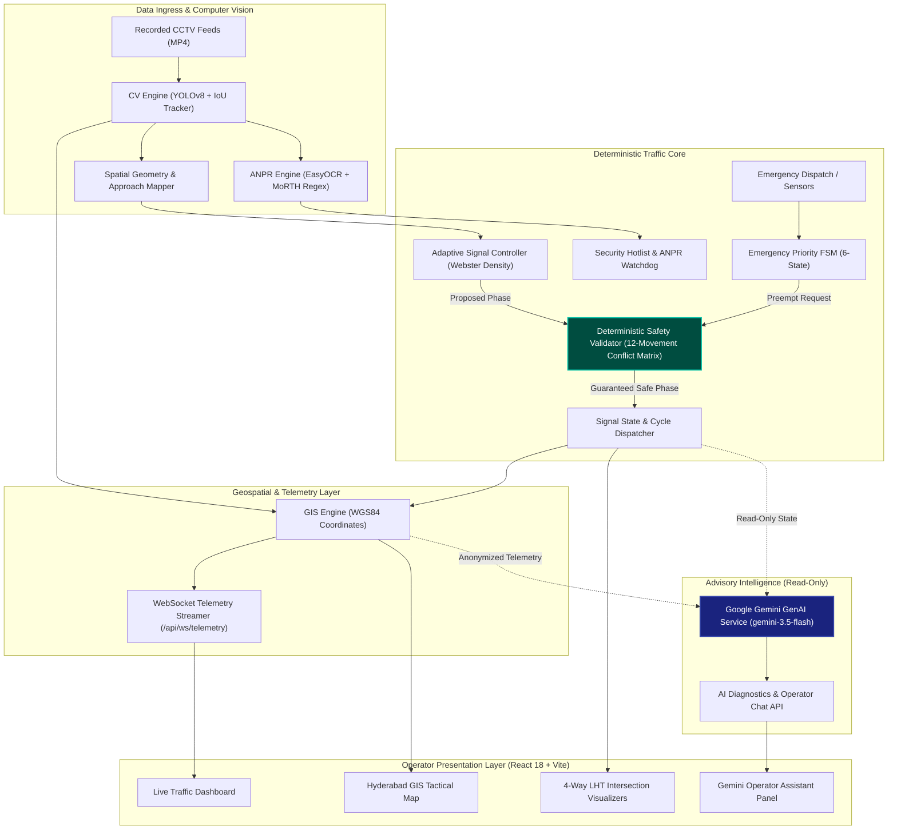

# NexTrAI — Urban Traffic Intelligence & Management Platform
## Architecture, Technical Specification & Operator Setup Guide

**Platform Version:** 2.0.0  
**Domain:** Intelligent Transportation Systems (ITS)  
**Standard Compliance:** IRC:67-2012 / MoRTH / Indian Motor Vehicles Act  
**Document Classification:** Production Architecture & Engineering Reference

---

## 1. System Overview

**NexTrAI** is an edge-native, real-time Intelligent Transportation Systems (ITS) platform designed for metropolitan arterial corridors. Operating along the high-density **Hyderabad Smart IT Arterial Corridor** (connecting Cyber Towers, Hitec City Mindspace, Bio-Diversity Junction, and Gachibowli), NexTrAI combines:

1. **Edge Computer Vision**: YOLOv8 multi-class vehicle detection, IoU persistent tracking, and MoRTH-compliant High Security Registration Plate (HSRP & BH-series) OCR.
2. **Deterministic Traffic Signal Optimization**: Dynamic Webster-delay phase green allocation dynamically balancing 4-way intersections under IRC:67 clearance safety constraints.
3. **Emergency Green Corridor Preemption**: A deterministic 6-state Finite State Machine (FSM) enabling green-wave progression for emergency response vehicles.
4. **Interactive GIS Command Map**: Leaflet.js geospatial visualizer rendering live intersection phases, camera placements, and vehicle spatial trajectories.
5. **Google Gemini Operations Intelligence**: Advisory AI assistant providing natural-language corridor summaries, signal decision explanations, and incident post-mortems without compromising safety isolation.

---

## 2. High-Level System Architecture



### Safety Isolation Invariant
> [!IMPORTANT]
> **Safety Isolation Principle**: Google Gemini and all LLM components are strictly isolated from signal actuation. The AI assistant possesses read-only access to anonymized telemetry and cannot command phase changes, override clearance intervals, or alter conflict matrices. All signal transitions are computed by the deterministic controller and verified by the immutable mathematical conflict matrix in `DeterministicSafetyValidator`.

---

## 3. Subsystem Architecture

### 3.1 Edge Computer Vision Engine (`backend/app/services/cv_engine.py`)
- **Detector**: Ultralytics YOLOv8 nano (`yolov8n.pt`), optimized for CPU/GPU inferencing.
- **Classification**: Detects Cars, 2-Wheelers (Motorcycles/Scooters), Auto-Rickshaws (heuristic aspect-ratio classifier on Indian 3-wheelers), Buses, and Trucks.
- **Tracker**: Intersection-over-Union (IoU) spatial centroid tracking with persistent IDs (`track_id`), velocity estimation, and crossing detection.
- **ANPR Engine** (`backend/app/services/anpr_engine.py`): Real-time license plate detection and character recognition via EasyOCR, validated against MoRTH Indian standards:
  - Standard State Plates: `^[A-Z]{2}[0-9]{1,2}[A-Z]{1,3}[0-9]{4}$` (e.g., `TS09EA1234`).
  - Bharat (BH) Series: `^[0-9]{2}BH[0-9]{4}[A-Z]{1,2}$` (e.g., `22BH1234AA`).
  - Positional character ambiguity sanitizer (`O` $\leftrightarrow$ `0`, `Z` $\leftrightarrow$ `2`, `I` $\leftrightarrow$ `1`).

### 3.2 Approach Mapping & Spatial Geometry (`backend/app/models/geometry.py`)
- **Normalized 2D Coordinate System**: Image-space coordinates normalized to $[0.0, 1.0]$.
- **Approach Polygons**: 4 approaches per intersection (North, South, East, West) with multi-lane polygons.
- **Crossing Line Detection**: Vector cross-product intersection detection preventing retreat/parallel false triggers.

### 3.3 Deterministic Signal Controller & Safety Layer
- **Adaptive Webster Controller** (`backend/app/services/adaptive_signal_service.py`): Computes green allocation proportional to directional queue pressure:
  $$\text{Green Allocation} = \text{Clamp}\left( G_{\min} + \frac{Q_i}{\sum Q} \times (G_{\max} - G_{\min}),\ G_{\min},\ G_{\max} \right)$$
  - Minimum Green: 10 seconds.
  - Maximum Green: 45 seconds.
  - Yellow Clearance: 3 seconds.
  - All-Red Clearance: 2 seconds.
- **12-Movement Conflict Safety Validator** (`backend/app/services/safety_validator.py`):
  - Strictly models Left-Hand Traffic (LHT) rules for Indian roads.
  - Evaluates all proposed simultaneous movements against an immutable conflict matrix.
  - Enforces minimum clearance times; rejects opposing or crossing through/right movements.

### 3.4 Emergency Priority Green Corridor FSM (`backend/app/services/emergency_priority_service.py`)
Deterministic 6-state lifecycle for emergency preemption:
1. `IDLE`: Normal adaptive Webster cycling.
2. `PREEMPTION_REQUESTED`: Verification of authorized emergency dispatch.
3. `CLEARING_CURRENT_PHASE`: Safe green termination with yellow (3s) and all-red (2s) clearance.
4. `HOLDING_GREEN`: Preempted approach held at GREEN for emergency transit.
5. `POST_PREEMPTION_RECOVERY`: Phased transition restoring green to the approach with highest queue debt.
6. `COOLDOWN`: Minimum cooldown interval before subsequent preemption can occur.

### 3.5 Geospatial GIS Topology (`backend/app/services/gis_engine.py`)
- Real-world WGS84 coordinates for the Cyber Towers ↔ Gachibowli corridor:
  - **I1 (Cyber Towers)**: `17.4504° N, 78.3808° E`
  - **I2 (Mindspace / Hitec City)**: `17.4435° N, 78.3772° E`
  - **I3 (Bio-Diversity Junction)**: `17.4325° N, 78.3685° E`
  - **I4 (Gachibowli Junction)**: `17.4225° N, 78.3485° E`
- Camera positions: Placed as directional offsets (`~60m–75m` along approach lines) labeled `APPROXIMATE_APPROACH_OFFSET`.
- CCTV Provenance: Formally tagged as `RECORDED_CCTV_REPLAY` with streaming health `ACTIVE_REPLAY_STREAM (FRESH)`.

### 3.6 Google Gemini AI Operations Assistant (`backend/app/services/gemini_service.py`)
- Official `google-genai` SDK v2.34.0.
- Multi-tier model fallback: `gemini-3.5-flash` $\rightarrow$ `gemini-3.5-flash-lite` $\rightarrow$ `gemini-3.8-flash` $\rightarrow$ Deterministic Heuristic Engine.
- Clean per-client `httpx.HTTPTransport(local_address="0.0.0.0")` with 25s timeout, guaranteeing rapid IPv4 resolution without global socket mutation.
- Input sanitization neutralizing prompt injections and redacting vehicle plates.

---

## 4. Environment Configuration

Create a `.env` file in the project root:

```env
# Application Mode
ENVIRONMENT=development
HOST=0.0.0.0
PORT=8000
LOG_LEVEL=INFO

# Google Gemini AI Integration
GEMINI_API_KEY=your_google_gemini_api_key_here
GEMINI_MODEL=gemini-3.5-flash

# Database & Storage
DATABASE_URL=sqlite+aiosqlite:///data/nextrai.db
SNAPSHOTS_DIR=data/snapshots

# Signal Timing Constraints (IRC:67)
MIN_GREEN_TIME=10
MAX_GREEN_TIME=45
YELLOW_TIME=3
ALL_RED_TIME=2

# CORS Configuration
CORS_ORIGINS=*
```

---

## 5. Step-by-Step Installation & Setup

### Prerequisites
- **Python**: Version 3.10 to 3.14
- **Node.js**: Version 18.x or 20.x (with `npm`)
- **OS**: Windows 10/11, Ubuntu 22.04+, or macOS Sonoma+

### 5.1 Backend Installation

```bash
# 1. Clone repository
git clone https://github.com/your-org/NexTrAI.git
cd NexTrAI

# 2. Set up Python virtual environment
python -m venv venv

# Windows activate:
venv\Scripts\activate
# Linux/macOS activate:
# source venv/bin/activate

# 3. Install backend dependencies
pip install -r backend/requirements.txt
```

### 5.2 Frontend Installation

```bash
# Navigate to frontend directory
cd frontend

# Install npm dependencies
npm install

# Return to root
cd ..
```

---

## 6. Running the Platform

### 6.1 Start FastAPI Backend Server

```bash
# From repository root with virtual environment activated:
python -m uvicorn app.main:app --app-dir backend --host 0.0.0.0 --port 8000 --reload
```
The backend starts at `http://127.0.0.1:8000`:
- **Swagger API Docs**: `http://127.0.0.1:8000/docs`
- **ReDoc Specification**: `http://127.0.0.1:8000/redoc`
- **Health Check**: `http://127.0.0.1:8000/api/health`

### 6.2 Start React Frontend Client

```bash
# In a separate terminal:
cd frontend
npm run dev
```
The React development server starts at `http://localhost:5173`.

### 6.3 Building for Production

```bash
# Build frontend static bundle
cd frontend
npm run build

# Output generated in frontend/dist/
```

---

## 7. Verification & Automated Testing Suite

NexTrAI includes a comprehensive 61-test suite covering all platform layers.

```bash
# Run full test suite with PYTHONPATH configured
python -m pytest backend/tests/ -o pythonpath=backend -v
```

### Test Suite Inventory

| Test Module | Tests | Verifies |
| :--- | :---: | :--- |
| `test_adaptive_signal.py` | 9 | Webster density allocation, CV pipeline queue ingestion, low/unbalanced/gridlock scenarios |
| `test_corridor_coordination.py` | 3 | Multi-intersection green-wave progression, transit offset timing |
| `test_emergency_priority.py` | 5 | 6-state emergency FSM, preemption hold, recovery phase debt |
| `test_gemini_integration.py` | 7 | Official SDK, prompt sanitization, safety gate isolation, cascade fallback |
| `test_geometry_schemas.py` | 8 | Normalized polygons, stop-line crossing vectors, approach association |
| `test_map_telemetry.py` | 4 | WGS84 junction nodes, camera offset markers, CCTV replay provenance |
| `test_nextrai.py` | 9 | Deterministic 12-movement conflict matrix, MoRTH regex plate sanitizer |
| `test_spatial_geometry.py` | 7 | 2D vector mathematics, segment intersection, directional filtering |
| `test_stage36_stage4_hardening.py` | 9 | Database schema migrations, crash recovery reconciliation, concurrency |
| **Total** | **61** | **100% Passing (0 failures, 0 errors)** |

---

## 8. Deployment Architecture (Railway / Cloud)

NexTrAI is configured for containerless deployment on Railway or any modern PaaS:
- `Procfile`: `web: bash start.sh`
- `railway.json` / `nixpacks.toml`: Python 3.14 build instructions and dynamic `$PORT` binding.
- Health Check: `/api/health`
- Reverse Proxy: Nginx or Cloudflare terminating SSL and forwarding WebSocket connections (`/api/ws/telemetry`).

---

## 9. Operational Safety Rules & Protocol

1. **Hardware Independence**: The prototype software operates against simulated and recorded telemetry. Physical field deployment requires certified safety hardware isolation (NEMA TS2 / 2070 controller conflict monitors).
2. **Deterministic Precedence**: In any scenario where AI output contradicts deterministic safety logic, the deterministic engine unconditionally overrides the advisory output.
3. **Fail-Safe Clearance**: Any network disconnect or signal error triggers the immediate application of an all-red clearance interval followed by standard fixed-time fail-safe flashing amber/red.
